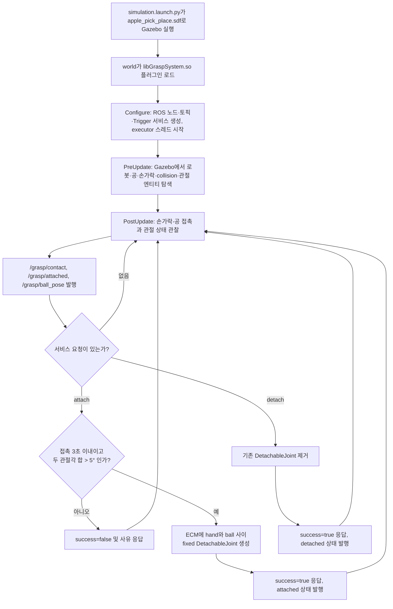

# GraspSystem 설명

## 한 문장 요약

`GraspSystem`은 Gazebo 시뮬레이션에 로드되는 사용자 정의 시스템 플러그인이다. RG2 손가락-공 접촉과 관절 상태를 관찰하고, ROS 2 서비스 요청에 따라 공과 로봇 손을 임시 `fixed` 연결로 묶거나 풀며, 상태와 공의 위치를 ROS 토픽으로 알린다.

## 육하원칙

| 원칙 | 설명 |
| --- | --- |
| **누가 (Who)** | Gazebo Harmonic의 `my_arm_with_ball_gazebo::GraspSystem` 플러그인이 동작 주체다. ROS 노드 `gazebo_grasp_system`을 내부에 만들며, `grasp_test.py` 같은 ROS 클라이언트가 서비스를 요청한다. |
| **무엇을 (What)** | 접촉 여부와 그리퍼 관절 상태를 감시하고, 명시적 요청을 받으면 Gazebo의 `DetachableJoint`를 만들어 공을 `rg2_hand`에 고정하거나 제거한다. 접촉·부착 상태 및 공 pose도 발행한다. |
| **언제 (When)** | `apple_pick_place.sdf`가 로드될 때 플러그인이 설정된다. 이후 매 Gazebo 업데이트에서 `PreUpdate`/`PostUpdate`가 실행된다. attach는 유효 접촉 기록이 3초 이내이고 관절각 합이 5°보다 클 때만 허용된다. |
| **어디서 (Where)** | 플러그인 구현은 `my_arm_with_ball_gazebo/src/GraspSystem.cc`; 월드 등록은 `my_arm_with_ball_gazebo/worlds/apple_pick_place.sdf`; 빌드·설치는 `my_arm_with_ball_gazebo/CMakeLists.txt`; ROS 호출자는 `my_arm_with_ball_application/scripts/grasp_test.py`다. |
| **왜 (Why)** | 단계 4 시뮬레이션 테스트에서 접촉을 확인한 뒤 공을 들어 올리고, 나중에 놓이는 흐름을 제어 가능하고 재현 가능하게 만들기 위해서다. 현재 동작은 마찰만으로 잡는 물리적 파지의 검증이 아니라 테스트용 연결 방식이다. |
| **어떻게 (How)** | ROS 서비스 콜백은 명령을 공유 상태에 기록하고 기다린다. Gazebo 업데이트 콜백이 해당 명령을 처리해 ECM(Entity Component Manager)을 변경하고, 완료 신호를 돌려준다. `PostUpdate`는 접촉·연결 상태와 pose 토픽을 발행한다. |

## 파일 간 연결 관계

```mermaid
flowchart LR
    CMAKE["my_arm_with_ball_gazebo/CMakeLists.txt<br/>GraspSystem 공유 라이브러리 빌드 및 설치"]
    LIB["libGraspSystem.so<br/>Gazebo가 불러오는 플러그인 라이브러리"]
    WORLD["worlds/apple_pick_place.sdf<br/>플러그인 등록 + ur5_rg2 및 apple 모델"]
    LAUNCH["bringup/launch/simulation.launch.py<br/>apple_pick_place.sdf로 Gazebo 실행"]
    SYS["src/GraspSystem.cc<br/>탐색 · 접촉/관절 관찰 · 연결/해제 · ROS API"]
    TEST["application/scripts/grasp_test.py<br/>/grasp/attach·detach 호출, 상태 검증"]
    SCENE["application/scripts/grasp_scene.py<br/>MoveIt Planning Scene의 collision object 갱신"]
    TOPIC["ROS 토픽<br/>/grasp/contact<br/>/grasp/attached<br/>/grasp/ball_pose"]
    SERVICES["ROS 서비스 (std_srvs/Trigger)<br/>/grasp/attach<br/>/grasp/detach"]
    MOVEIT["MoveIt Planning Scene<br/>apply/get_planning_scene"]

    CMAKE -->|빌드/설치| LIB
    LAUNCH -->|실행| WORLD
    WORLD -->|플러그인 선언| LIB
    LIB --> SYS
    WORLD -->|엔티티 이름·구성 제공| SYS
    SYS -->|서비스 서버| SERVICES
    TEST -->|요청| SERVICES
    SYS -->|상태 발행| TOPIC
    TOPIC -->|구독| TEST
    TEST -->|별도 장면 갱신 요청| SCENE
    SCENE --> MOVEIT
```

**중요한 분리:** Gazebo의 물리 연결과 MoveIt의 충돌 장면은 서로 독립적이다. `GraspSystem`은 MoveIt Planning Scene을 직접 수정하지 않는다. 테스트 노드가 Gazebo 서비스를 호출하는 흐름과 별도로 `grasp_scene.py` 함수를 호출해 MoveIt 장면도 동기화한다.

## 실행 흐름

## 내부 동작을 단계별로 보면

### 1. 설정과 인터페이스 생성 — `Configure()`

플러그인이 시작되면 독립 `rclcpp::Context`와 `gazebo_grasp_system` 노드를 만들고, 다음 ROS 인터페이스를 생성한다.

| 인터페이스 | 타입 | 방향 및 의미 |
| --- | --- | --- |
| `/grasp/attach` | `std_srvs/srv/Trigger` | 요청: 공을 손에 붙여 달라. 조건을 검사해 연결을 시도한다. |
| `/grasp/detach` | `std_srvs/srv/Trigger` | 요청: 공과 손 사이 연결을 해제한다. |
| `/grasp/contact` | `std_msgs/msg/Bool` | 발행: 손가락 collision과 공 collision 접촉 여부. |
| `/grasp/attached` | `std_msgs/msg/Bool` | 발행: 플러그인이 관리하는 고정 연결 존재 여부. |
| `/grasp/ball_pose` | `geometry_msgs/msg/PoseStamped` | 발행: Gazebo 기준 월드 좌표계에서의 공 pose. `frame_id`는 `world`. |

ROS executor는 별도 스레드에서 서비스 요청을 처리한다. 서비스 콜백에서 Gazebo의 ECM을 직접 바꾸지 않고, 명령을 저장한 뒤 업데이트 콜백이 처리할 때까지 기다린다. 시뮬레이션이 멈춰 있거나 요청이 2초 안에 처리되지 않으면 실패 응답을 준다.

### 2. Gazebo 엔티티 탐색 — `Discover()`

`PreUpdate()`는 아직 엔티티를 찾지 못했다면 다음 이름을 기준으로 Gazebo ECM에서 찾는다.

- 모델 `ur5_rg2`, 링크 `rg2_hand`
- 모델 `apple`, 링크 `ball`
- 로봇 링크 `rg2_leftfinger`, `rg2_rightfinger`의 collision들
- 공 `ball` 링크의 collision
- `rg2_finger_joint1`, `rg2_finger_joint2`

필수 엔티티가 전부 준비되면 엔티티 핸들을 저장하고, 손가락 collision에 `ContactSensorData`, 관절에 `JointPosition` 컴포넌트가 없을 경우 생성한다. 그러므로 모델/링크/관절 이름이 바뀌면 이 탐색 로직도 함께 검토해야 한다.

### 3. 접촉·상태 관찰 — `PostUpdate()`

양쪽 손가락 collision의 `ContactSensorData`를 읽어 그 충돌 상대가 공 collision인지 확인한다. 유효한 접촉과 관절 각도 조건이 관찰되면 접촉 시각을 기록한다. ROS 토픽은 매 20번째 시뮬레이션 iteration마다 발행된다. 공 월드 pose도 같은 주기로 발행된다.

### 4. 공을 붙이거나 놓기 — `PreUpdate()`

서비스 요청은 내부 `Attach` 또는 `Detach` 명령으로 전달된다. `PreUpdate()`가 대기 명령을 읽고 다음처럼 처리한다.

- **Attach:** 엔티티 준비 여부를 확인하고, 이미 부착되어 있으면 성공으로 응답한다. 새 연결은 유효 접촉 기록이 3초 이내이며 두 손가락 관절 위치 합이 5°보다 클 때만 만든다. 연결은 ECM에 `DetachableJoint({hand, ball, "fixed"})` 컴포넌트를 추가하는 방식이다.
- **Detach:** 저장된 joint 엔티티가 있으면 제거 요청을 ECM에 넣고 내부 핸들을 비운다. 이미 연결이 없어도 성공으로 응답한다.

유효 접촉 기록은 그리퍼 닫힘 action의 취소가 완료되는 동안 순간적으로 접촉이 사라지는 경우를 허용하기 위한 짧은 유예다. attach 요청 시 현재 관절 조건은 다시 확인한다.

## 책임 범위와 한계

- `GraspSystem`은 **Gazebo 쪽 접촉 감지와 테스트용 물리 연결**의 책임을 가진다.
- MoveIt은 별도 Planning Scene에서 충돌 물체의 월드/로봇 부착 상태를 관리한다. `grasp_scene.py`와 `grasp_test.py`가 그 동기화 흐름을 담당한다.
- `fixed` 연결은 공이 미끄러지지 않도록 손에 강제로 묶는 모델이다. 따라서 성공적인 물리 마찰 파지를 증명하지 않는다.
- 이름 탐색은 현재 SDF의 고정된 모델·링크·관절 이름에 의존한다. 재사용 가능한 범용 grasp 프레임워크가 아니라 이 시뮬레이션 구성에 맞춘 플러그인이다.

## 주요 파일 요약

| 파일 | 관계/책임 |
| --- | --- |
| `my_arm_with_ball_gazebo/src/GraspSystem.cc` | 플러그인 본체. Gazebo 업데이트 훅, 엔티티 조회, ROS 서비스/토픽, attach/detach 동작 정의. |
| `my_arm_with_ball_gazebo/worlds/apple_pick_place.sdf` | Gazebo world에 플러그인과 `ur5_rg2`/`apple`을 선언한다. |
| `my_arm_with_ball_gazebo/CMakeLists.txt` | `GraspSystem.cc`에서 `GraspSystem` 공유 라이브러리를 만들고 패키지 lib 디렉터리에 설치한다. |
| `my_arm_with_ball_bringup/launch/simulation.launch.py` | 해당 world 파일을 Gazebo에 전달해 플러그인이 로드되는 시뮬레이션을 시작한다. |
| `my_arm_with_ball_application/scripts/grasp_test.py` | 토픽 구독 및 attach/detach 서비스 클라이언트. 접촉-부착-들기-해제 테스트를 순서화한다. |
| `my_arm_with_ball_application/scripts/grasp_scene.py` | Gazebo 플러그인과는 별개로 MoveIt Planning Scene의 공 collision object를 붙이거나 되돌린다. |
