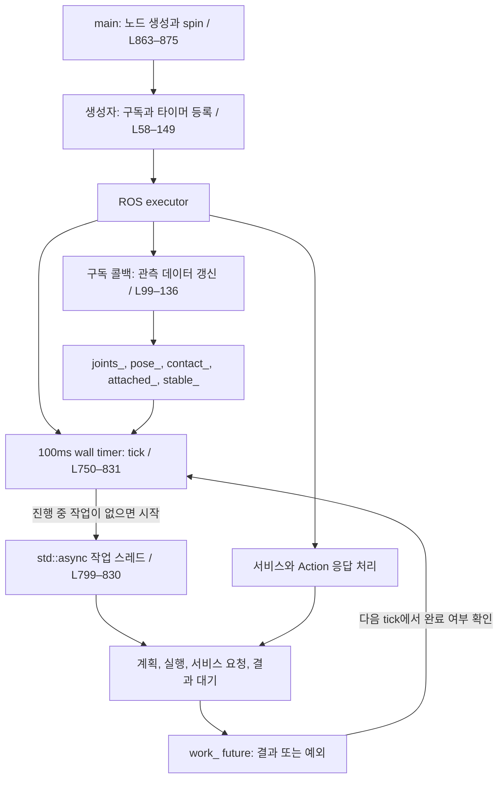
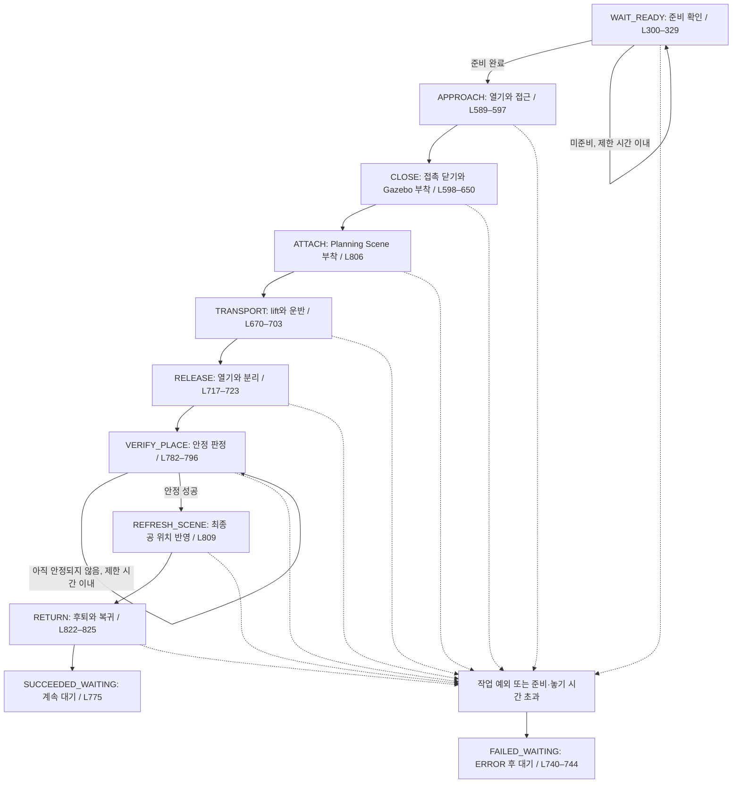
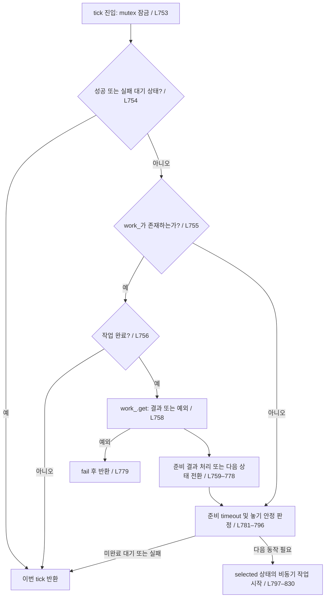

# pick_and_place_test.cpp 코드 해설

## 1. 읽는 방법

이 문서는 **실행 구조 → 상태 전이 → 단계별 함수 → 공통 도우미** 순서로 코드를 따라 읽기 위한 안내서다. 전체 작업은 C++ 상태 머신이 조율하고, 이동 구간별로 MTC Task를 생성한다. 하나의 MTC Task가 Gazebo 확인까지 모두 실행하는 구조는 아니다.

- 분석 대상: [pick_and_place_test.cpp L1–875](../my_arm_with_ball_application/src/pick_and_place_test.cpp#L1-L875)
- 링크 형식: [마크다운테스트.md](마크다운테스트.md)의 `상대경로#L시작-L끝` 형식을 사용한다.
- 행 번호는 문서 작성 시점의 소스 기준이다. 코드 변경 시 함께 갱신해야 한다. 뷰어가 행 앵커를 지원하지 않으면 표에 적힌 함수명과 행 번호로 찾아간다.
- 흐름도는 Mermaid 지원 뷰어에서 표시된다. 도형에 적힌 행 번호의 실제 이동 링크는 바로 아래 표에서 제공한다.

추천 읽기 순서:

1. [main() L863–875](../my_arm_with_ball_application/src/pick_and_place_test.cpp#L863-L875): 실행 시작점.
2. [생성자 L58–149](../my_arm_with_ball_application/src/pick_and_place_test.cpp#L58-L149): 파라미터, 구독, 클라이언트, 타이머 등록.
3. [tick() L750–831](../my_arm_with_ball_application/src/pick_and_place_test.cpp#L750-L831): 전체 흐름의 중심.
4. 아래 단계 연결표에서 관심 있는 함수로 이동.
5. 서비스·액션·MTC 공통 도우미를 확인.

## 2. 전체 실행 구조: 누가 무엇을 실행하는가

| 구성 | 읽을 코드 | 역할 |
| --- | --- | --- |
| 시작점 | [main() L863–875](../my_arm_with_ball_application/src/pick_and_place_test.cpp#L863-L875) | 노드를 만들고 `MultiThreadedExecutor::spin()`으로 ROS 콜백을 처리한다. |
| 관측 수집 | [구독 콜백 L99–136](../my_arm_with_ball_application/src/pick_and_place_test.cpp#L99-L136) | 관절, 접촉, 부착, 공 pose와 수신 시각을 저장한다. 공 pose 콜백은 놓기 판정도 갱신한다. |
| 주기 실행 | [타이머 등록 L147](../my_arm_with_ball_application/src/pick_and_place_test.cpp#L147) | `create_wall_timer(100ms, ...)`로 `tick()`을 호출한다. |
| 상태 관리 | [tick() L750–796](../my_arm_with_ball_application/src/pick_and_place_test.cpp#L750-L796) | 작업 결과를 확인하고 다음 상태 또는 실패 대기로 전환한다. |
| 실제 작업 | [작업 분기 L797–830](../my_arm_with_ball_application/src/pick_and_place_test.cpp#L797-L830) | 현재 상태를 복사한 `selected`에 따라 별도 스레드에서 해당 함수를 실행한다. |
| 공유 데이터 보호 | [멤버 L833–860](../my_arm_with_ball_application/src/pick_and_place_test.cpp#L833-L860) | `mutex_`, `planning_mutex_`, `stopping_`, `work_` 등이 콜백과 작업 스레드를 연결한다. |

### 중요한 구분

- `tick()`은 `work_.wait_for(0ms)`로 **완료 여부만 확인**한다. 작업이 끝나지 않았다면 바로 반환한다.
- 실제 작업 스레드에는 `await()`의 future 대기와 접촉·부착·관절 확인 루프가 있다. **타이머 기반이라고 모든 함수가 비블로킹인 것은 아니다.** 블로킹 작업을 executor 콜백 밖으로 분리한 구조다.
- 이 파일은 별도 callback group을 지정하지 않는다. `MultiThreadedExecutor`가 있다는 사실만으로 이 노드의 기본 그룹 콜백들이 병렬 실행된다고 읽으면 안 된다. 작업과 ROS 콜백의 동시 진행에서 핵심은 `std::async` 분리다.
- `mutex_`는 콜백과 작업 스레드의 관측 데이터 접근을 보호하고, `planning_mutex_`는 종료 시 사용할 `planning_task_` 포인터를 보호한다.

## 3. 작업 상태 전이도

상태 정의는 [L164–177](../my_arm_with_ball_application/src/pick_and_place_test.cpp#L164-L177), 로그용 이름은 [stateName() L724–739](../my_arm_with_ball_application/src/pick_and_place_test.cpp#L724-L739)에 있다. `CLOSE`는 로그에서 `CLOSE_CONTACT`, `ATTACH`는 `ATTACH_SCENE`으로 출력된다.

### 단계별 코드 연결표

| 단계 | 실제 호출 경로와 코드 | 하는 일 및 다음 단계 조건 |
| --- | --- | --- |
| 준비 | [tick → readiness() L800–801](../my_arm_with_ball_application/src/pick_and_place_test.cpp#L800-L801), [함수 L300–329](../my_arm_with_ball_application/src/pick_and_place_test.cpp#L300-L329) | 최신 관측, 3개 active 컨트롤러, Action/서비스, 장면의 apple/basket을 확인한다. 빈 문자열이면 준비 완료. |
| 접근 | [approach() L589–597](../my_arm_with_ball_application/src/pick_and_place_test.cpp#L589-L597) | 접촉 충돌 허용 → 그리퍼 열기 → 시작 관절 → pregrasp 관절 → grasp pose를 MTC로 계획·실행한다. |
| 접촉 닫기 | [closeContact() L598–650](../my_arm_with_ball_application/src/pick_and_place_test.cpp#L598-L650) | `/move_action`으로 그리퍼를 닫고 접촉을 기다린다. 접촉 후 필요 시 goal 취소, 종료 결과와 손가락 개방량을 확인한 뒤 `trigger(true)`로 Gazebo 부착을 요청한다. |
| 장면 부착 | [ATTACH 분기 L806](../my_arm_with_ball_application/src/pick_and_place_test.cpp#L806), [syncScene() L406–441](../my_arm_with_ball_application/src/pick_and_place_test.cpp#L406-L441) | Gazebo 부착 상태 확인 후 MoveIt의 공을 손에 부착된 물체로 반영하고 조회 검증한다. **Gazebo 부착 요청은 앞 단계에서 이미 수행한다.** |
| 운반 | [transport() L670–703](../my_arm_with_ball_application/src/pick_and_place_test.cpp#L670-L703) | 수직 lift MTC Task → 부착 확인 → 손/공 XY 오프셋 보정 → 바구니 위 이동 MTC Task → 부착 확인. |
| 놓기 | [release() L717–723](../my_arm_with_ball_application/src/pick_and_place_test.cpp#L717-L723) | MTC로 손가락을 연 뒤 Gazebo 분리를 요청하고 MoveIt 장면의 공을 월드 물체로 바꾼다. |
| 안정 판정 | [pose 콜백 L119–136](../my_arm_with_ball_application/src/pick_and_place_test.cpp#L119-L136), [tick 판정 L782–796](../my_arm_with_ball_application/src/pick_and_place_test.cpp#L782-L796) | 콜백이 `stable_`을 계산한다. 타이머는 성공·대기·시간 초과를 결정한다. 이 상태에서는 새 작업 스레드를 반복 생성하지 않는다. |
| 장면 재갱신 | [REFRESH_SCENE 분기 L809](../my_arm_with_ball_application/src/pick_and_place_test.cpp#L809) | 공이 분리된 상태인지 확인하고 정착한 공의 최신 pose를 `syncScene(false, true)`로 반영한다. |
| 후퇴·복귀 | [RETURN 분기 L822–825](../my_arm_with_ball_application/src/pick_and_place_test.cpp#L822-L825) | retreat pose → 저장한 시작 관절로 복귀하는 MTC Task를 실행하고 손과 공의 접촉 허용을 해제한다. |
| 성공·실패 대기 | [fail() L740–744](../my_arm_with_ball_application/src/pick_and_place_test.cpp#L740-L744), [종료 상태 반환 L754](../my_arm_with_ball_application/src/pick_and_place_test.cpp#L754), [성공 전환 L775](../my_arm_with_ball_application/src/pick_and_place_test.cpp#L775) | 타이머는 바로 반환한다. 자동 재실행이나 정상 작업 실패에 따른 노드 종료는 하지 않는다. |

## 4. tick()을 읽는 순서

위 그림은 제어 흐름 요약이다. 정확한 분기는 [tick() 전체 L750–831](../my_arm_with_ball_application/src/pick_and_place_test.cpp#L750-L831)를 참고한다. 특히 준비 결과가 아직 미충족이면 L761–763에서 반환하고 다음 tick에서 다시 준비 작업을 시작한다.

`work_`가 진행 중이면 새 작업을 시작하지 않으므로 작업 단계가 중복 실행되지 않는다. 작업 함수가 정상 반환한 뒤에야 L768–776에서 다음 상태로 넘어간다. `VERIFY_PLACE`는 예외적으로 구독 콜백이 만든 판정값을 타이머가 직접 처리한다.

## 5. MTC는 어디에 적용되는가

| 함수 | MTC 구성 | 코드 |
| --- | --- | --- |
| `configureTask()` | 로봇 모델과 현재 Planning Scene을 읽고 `FixedState`를 시작 상태로 추가한다. | [L535–543](../my_arm_with_ball_application/src/pick_and_place_test.cpp#L535-L543) |
| `addJointMove()` | `PipelinePlanner`와 `MoveTo`를 사용한다. 관절 이름과 목표값을 대응시킨다. | [L544–555](../my_arm_with_ball_application/src/pick_and_place_test.cpp#L544-L555) |
| `addPoseMove()` | `GeneratePose`를 `ComputeIK`로 감싸고 `Connect`와 연결한다. 목표 pose의 IK 해와 연결 경로를 찾는다. | [L556–571](../my_arm_with_ball_application/src/pick_and_place_test.cpp#L556-L571) |
| `transport()`의 lift | `CartesianPath`와 `MoveRelative`로 월드 +Z 방향 수직 이동을 만든다. | [L673–690](../my_arm_with_ball_application/src/pick_and_place_test.cpp#L673-L690) |
| `executeTask()` | 초기화 → `task.plan(3)` → 첫 solution을 메시지로 변환 → 컨트롤러 지정 → `/execute_task_solution`으로 실행 → 결과 및 관절 도달 확인. | [L480–534](../my_arm_with_ball_application/src/pick_and_place_test.cpp#L480-L534) |

**목표와 경로는 다르다.** [설정 YAML](../my_arm_with_ball_application/config/pick_and_place_test.yaml)의 pregrasp 관절과 grasp/place/retreat pose는 목표값이다. 그 사이 궤적은 계획 시 생성된다. `lift_pose`는 현재 구현에서 Z만 사용하며, `place_pose`의 XY는 측정된 공-손 차이를 빼서 보정한다.

그리퍼 접촉 닫기는 MTC Task가 아니라 [closeContact()의 MoveGroup Action L600–615](../my_arm_with_ball_application/src/pick_and_place_test.cpp#L600-L615)을 사용한다. 접촉에 반응해 실행을 취소해야 하는 구간이므로 다른 이동 구간과 읽는 경로가 다르다.

## 6. Gazebo 물리 상태와 MoveIt 장면은 별개다

| 책임 | 함수와 코드 | 확인 내용 |
| --- | --- | --- |
| 물리 부착·분리 | [trigger() L447–461](../my_arm_with_ball_application/src/pick_and_place_test.cpp#L447-L461) | `/grasp/attach` 또는 `/grasp/detach` 서비스 성공 뒤 `/grasp/attached` 관측이 요청한 값인지 기다린다. |
| 부착 유지 확인 | [requireAttachment() L442–446](../my_arm_with_ball_application/src/pick_and_place_test.cpp#L442-L446) | 부착 관측의 최신성과 값을 확인한다. 실제 부착 동작을 실행하는 함수는 아니다. |
| 장면 변경 | [syncScene() L406–441](../my_arm_with_ball_application/src/pick_and_place_test.cpp#L406-L441) | 부착 시 공 pose를 손 좌표계로 변환하고, 분리 시 월드 pose로 반영한다. |
| 장면 검증 | [verifyScene() L366–405](../my_arm_with_ball_application/src/pick_and_place_test.cpp#L366-L405) | 공의 world/attached 소속, 구 형상·반지름·좌표계 및 위치 오차를 검증한다. |
| 접촉 허용 | [touchAllowed() L346–365](../my_arm_with_ball_application/src/pick_and_place_test.cpp#L346-L365) | Planning Scene의 공과 손 링크 사이 충돌 허용을 바꾼다. Gazebo의 물리 충돌을 끄는 함수가 아니다. 공과 pick_area_floor의 허용은 true로 둔다. |

추적 예: **접촉 확인 → `trigger(true)` → Gazebo 부착 관측 → ATTACH 상태 → `syncScene(true)` → `verifyScene()` → 운반**.

## 7. 놓기 판정과 시간 기준

판정 구현은 별도 헤더의 [PlaceStability::update() L17–45](../my_arm_with_ball_application/src/place_stability.hpp#L17-L45)에 있다.

1. 공 중심이 `basket_bounds`의 X/Y/Z 범위 안인지 확인한다.
2. 연속 공 위치의 이동 거리 ÷ 메시지 timestamp 차이로 속력을 추정한다.
3. 내부 위치와 저속 조건을 연속 만족한 시간이 `stable_duration` 이상이면 성공이다.
4. 위치·속도 조건이 깨지면 안정 시간 누적을 초기화한다. 첫 표본만으로는 속력을 알 수 없어 성공하지 않는다.
5. 타이머는 관측이 오래됐으면 판정을 초기화하고, `place_timeout` 초과 시 실패로 바꾼다.

| 시간 용도 | 실제 기준 | 코드 |
| --- | --- | --- |
| 타이머 호출 | wall timer, 100ms | [L147](../my_arm_with_ball_application/src/pick_and_place_test.cpp#L147) |
| 준비/놓기 제한시간, 수신 최신성, 자체 대기 | `std::chrono::steady_clock` | [Clock 별칭 L48](../my_arm_with_ball_application/src/pick_and_place_test.cpp#L48), [secondsSince/fresh L198–201](../my_arm_with_ball_application/src/pick_and_place_test.cpp#L198-L201) |
| 공 속력과 연속 안정 시간 | 공 pose 메시지의 stamp | [L132–134](../my_arm_with_ball_application/src/pick_and_place_test.cpp#L132-L134) |

따라서 `use_sim_time=true`라고 해서 이 파일의 모든 제한시간이 시뮬레이션 시간으로 바뀌는 것은 아니다. 시뮬레이션을 멈춰도 wall timer와 steady-clock 기반 제한시간은 계속 진행한다.

## 8. 공통 도우미: 필요한 때 찾아보기

| 함수 | 역할 및 주의점 | 코드 |
| --- | --- | --- |
| `parameter()`, `poseParameter()` | 설정 읽기, pose 배열 검사, quaternion 정규화. YAML override가 있으면 C++ 기본값보다 우선한다. | [L178–197](../my_arm_with_ball_application/src/pick_and_place_test.cpp#L178-L197) |
| `measured()`, `ball()` | 최신 관절 또는 공 pose를 잠금 아래 복사해 가져온다. 오래된 값이면 예외. | [L202–219](../my_arm_with_ball_application/src/pick_and_place_test.cpp#L202-L219) |
| `await()` | 작업 스레드에서 future를 50ms씩 기다리고 종료·timeout을 확인한다. ROS 콜백을 직접 spin하지 않는다. | [L220–227](../my_arm_with_ball_application/src/pick_and_place_test.cpp#L220-L227) |
| `sendGoal()`, `cancelLateGoal()` | goal 승인 대기와, timeout 후 뒤늦게 승인된 goal의 취소·결과 로깅을 처리한다. | [L228–285](../my_arm_with_ball_application/src/pick_and_place_test.cpp#L228-L285) |
| `call()` | 비동기 서비스 요청 후 5초까지 응답을 기다린다. 실패 시 pending request를 제거한다. | [L286–293](../my_arm_with_ball_application/src/pick_and_place_test.cpp#L286-L293) |
| `scene()`, `apply()` | 현재 Planning Scene 조회 및 diff 적용. | [L294–299](../my_arm_with_ball_application/src/pick_and_place_test.cpp#L294-L299), [L330–336](../my_arm_with_ball_application/src/pick_and_place_test.cpp#L330-L336) |
| `sphere()` | 반지름 0.0325m의 apple 충돌 물체 생성. | [L337–345](../my_arm_with_ball_application/src/pick_and_place_test.cpp#L337-L345) |
| `verifyJoints()` | 최종 관절 오차가 0.025rad 이하인지 최대 5초 확인한다. | [L462–479](../my_arm_with_ball_application/src/pick_and_place_test.cpp#L462-L479) |
| `advance()`, `fail()` | 정상 상태 전이 또는 ERROR 기록 후 실패 대기. | [L740–749](../my_arm_with_ball_application/src/pick_and_place_test.cpp#L740-L749) |
| 소멸자 | 종료 플래그 설정, 진행 중 계획 preempt, 작업 future 종료 대기. | [L151–161](../my_arm_with_ball_application/src/pick_and_place_test.cpp#L151-L161) |

## 9. 오해하기 쉬운 지점

- `operation_timeout`은 전체 Pick-and-Place의 공통 마감 시간이 아니다. MTC 실행 결과 대기에 사용되며, 서비스 5초·goal 승인 10초·접촉 대기 30초 등 별도 상수 제한도 있다.
- 시작 관절 `start_`는 설정이 비어 있으면 **준비 완료 시점**에 저장한다([L765](../my_arm_with_ball_application/src/pick_and_place_test.cpp#L765)). 생성 직후 무조건 저장하는 것이 아니다.
- 준비 확인은 인터페이스 가용성, 컨트롤러 상태, 관측 및 장면을 검사한다. 준비 단계에서 시험 경로를 계획해 성공까지 확인하는 것은 아니다.
- 운반 중 부착 확인은 함수에 표시된 지점에서 수행한다. 모든 궤적 샘플마다 부착을 감시해 즉시 정지시키는 구현으로 해석하면 안 된다.
- 일반 작업 실패는 `FAILED_WAITING`으로 남지만, **생성자 실패 등 main의 catch로 전파된 예외**는 [L870–872](../my_arm_with_ball_application/src/pick_and_place_test.cpp#L870-L872)에서 노드를 종료한다.
- 이 문서는 현재 코드의 읽기 안내다. 새 런타임 시험이나 SingleThreadedExecutor 비교 성능 검증 결과를 의미하지 않는다.
